# 基于Vue.js的游戏公司官网的设计与实现

> 公开脱敏版：保留论文正文与技术插图；学校模板、页眉页脚、校徽、身份元数据不进入公开文件，含个人资料或凭据的截图已隐藏。

目 录

## 绪论

### 选题背景

在当今数字化时代，互联网已经成为了人们获取信息、交流互动的主要渠道之一。随着互联网的普及和发展，各行各业都纷纷将业务拓展到了网络平台上，其中包括游戏产业和企业服务领域。游戏官网和企业官网作为企业或产品在网络上的展示窗口，承载着向用户展示企业形象、产品信息和服务优势的重要任务。

游戏官网是游戏开发商或发行商在网络上为其游戏产品建立的官方网站。在一个游戏官网上，游戏开发商会向玩家介绍他们的游戏产品、提供游戏相关的新闻资讯、发布游戏更新内容、提供玩家支持和社区交流平台等功能。通常，游戏官网的设计风格会与游戏的风格相符合，以营造出一种与游戏世界相契合的氛围。例如，如果游戏是一款科幻题材的游戏，那么官网可能会采用未来科技感十足的设计风格；如果是一款童趣的休闲游戏，官网可能会运用可爱、活泼的设计元素。

而企业官网则是企业在网络上展示自身形象、产品与服务的官方网站。企业官网不仅是企业品牌的重要展示平台，也是企业与用户、客户沟通的重要渠道。通过企业官网，企业可以向用户介绍公司的历史沿革、核心价值观、产品与服务、业务范围等信息，从而增强用户对企业的了解和信任。此外，企业官网还是企业与用户进行沟通交流、提供在线客户服务的主要渠道之一，通过企业官网用户可以方便地获取产品信息、提出问题和建议、参与活动等。

无论是游戏官网还是企业官网，背后都有着深厚的设计和技术支持。一个成功的官网不仅需要有吸引人的页面设计和流畅的用户体验，还需要有稳定的技术支持和优质的内容输出。在设计方面，官网的页面布局、配色方案、视觉效果等都需要经过精心的策划和设计，以确保能够吸引用户的注意力并传达出企业或游戏的品牌形象和核心价值。在技术方面，官网需要具备响应式设计、快速加载速度、安全性等基本要求，同时还需要具备一定的交互性和动态效果，以提升用户体验。

综上所述，游戏官网和企业官网在当今互联网时代扮演着重要的角色，它们不仅是企业或产品在网络上的展示窗口，更是企业与用户、客户交流互动的重要平台。通过精心设计和技术支持，官网能够有效地传达企业或游戏的形象、品牌价值，并为用户提供优质的服务和体验。

### 国内外发展现状

在当今数字化和全球化的时代，游戏产业和企业服务领域都处于快速发展的阶段，国内外在这两个领域的发展现状各有特点。

首先，就游戏产业而言，国内外都呈现出了蓬勃的发展态势。国外游戏市场，特别是北美、欧洲和日本等发达国家，已经形成了成熟、多样化的游戏产业生态系统。这些国家的游戏开发商和发行商积累了丰富的经验和技术，推出了众多优秀的游戏作品，深受玩家喜爱。同时，随着移动互联网的普及，手机游戏、社交游戏等新兴游戏形式也逐渐崭露头角，成为游戏市场的新宠。而在国内，随着经济的快速发展和互联网的普及，中国游戏产业也迎来了快速增长的时期。中国已经成为全球最大的游戏市场之一，拥有庞大的玩家群体和活跃的游戏社区。众多国内游戏企业涌现出了一大批优秀的游戏作品，涵盖了不同的游戏类型和风格，为中国游戏产业的发展贡献了力量。

其次，在企业服务领域，国内外的发展现状也各具特点。国外的企业服务市场相对成熟，各类企业服务提供商竞争激烈，服务范围涵盖了企业的各个方面，包括人力资源、财务、市场营销、信息技术等。企业服务提供商通过不断创新和优化服务，为客户提供高质量、个性化的服务，助力企业实现业务增长和发展目标。而在国内，随着中国经济的快速发展和产业结构的不断优化，企业对于专业化、高效化的服务需求日益增加。国内的企业服务市场也呈现出了蓬勃的发展态势，各类企业服务平台和机构如雨后春笋般涌现，为企业提供各种专业化、定制化的服务，推动了中国企业的转型升级和创新发展。

国内外在游戏产业和企业服务领域的发展现状都呈现出了蓬勃的态势。在游戏产业方面，随着技术的不断创新和市场的不断扩大，游戏产业将继续保持快速增长的势头。而在企业服务领域，随着经济的发展和企业对服务需求的不断提升，企业服务市场也将持续扩大，并呈现出更加多样化、专业化的发展趋势。

### 目的与意义

彰显企业形象与品牌价值：官网是企业在互联网上展示自身形象、核心价值观和品牌形象的重要窗口。通过精心设计的页面布局、视觉效果和内容呈现，官网能够向用户传递企业的专业性、信誉度和品牌价值，从而塑造良好的企业形象。

提供产品与服务信息：官网是企业向用户介绍产品与服务的主要渠道之一。通过官网，用户可以了解企业提供的产品特点、功能优势、价格策略等信息，以及企业的售后服务、客户支持等服务内容，从而为用户提供全面的产品信息和服务保障。

拓展市场与客户群体：官网是企业拓展市场、开拓客户群体的重要平台。通过官网，企业可以实现全球范围内的信息传播和市场拓展，吸引更多潜在客户的关注和访问，从而扩大企业的影响力和市场份额。

强化品牌推广与营销：官网是企业品牌推广和营销的重要工具之一。通过官网，企业可以发布最新的产品信息、推出优惠活动和促销策略，吸引用户关注和参与，提升品牌知名度和用户忠诚度，从而实现销售增长和市场份额提升。

提升用户体验与互动性：官网是企业与用户互动、交流的主要平台之一。通过官网，用户可以方便快捷地获取所需信息、提出问题和建议、参与讨论和社交互动等，从而提升用户体验和满意度，增强用户对企业的认同感和忠诚度。

官网作为企业在互联网上的正式展示平台，其目的与意义十分重大。通过官网，企业可以有效地展示形象与品牌价值、提供产品与服务信息、拓展市场与客户群体、强化品牌推广与营销、提升用户体验与互动性，从而实现企业的发展目标和长期增长。

### 章节内容安排

## 第一章：主要讲述本题目开发背景，开发目的与意义，国内外发展现状。

## 第二章：主要阐述本系统使用到的关键技术：Node.js框架，Vue.js框架，Axios，MySQL数据库，Koa框架。

## 第三章：对系统进行需求分析，进行功能性需求分析，确定系统的使用群体，确定系统的基本功能；对系统进行非功能性需求分析。

## 第四章：阐述系统的架构设计，总体设计，对系统关键功能进设计，并画出关键功能的序列图；对系统数据库进行设计，使用三段式设计系统的数据库。

## 第五章：合理运用文字，系统实现界面，代码对实现的功能进行阐述，关键代码进行解释。

## 第六章：使用黑盒测试方法对系统的关键功能：登录，用户管理，新闻管理，产品管理，职位管理，前台首页，新闻查询等功能进行测试，保证系统的稳定性。

## 第七章：对本系统的设计与开发工作进行总结。

## 关键技术介绍

### 关键性开发技术介绍

#### Node.js

Node.js 是一个基于 Chrome V8 引擎的 JavaScript 运行时环境，使用事件驱动、非阻塞 I/O 模型，使其成为构建高性能、可扩展网络应用程序的理想选择。Node.js 的核心特点包括：事件驱动: Node.js 使用事件驱动的编程范式，所有的 I/O 操作都是异步的，通过回调函数来处理。这种模型使得 Node.js 能够处理大量并发连接，高效地处理 I/O 密集型任务。非阻塞 I/O: Node.js 使用非阻塞的 I/O 模型，可以在进行文件读写、网络通信等操作时继续执行后续的代码，而不必等待 I/O 操作完成。这种方式能够提高系统的吞吐量和响应速度。单线程: Node.js 使用单线程模型来处理请求，但是通过事件循环机制和异步 I/O，能够支持高并发和大规模的请求处理。此外，Node.js 也支持通过创建子进程来利用多核 CPU。跨平台: Node.js 可以在多种操作系统上运行，包括 Windows、Linux 和 macOS 等，具有良好的跨平台性和可移植性。模块化: Node.js 支持模块化开发，通过 CommonJS 或 ES6 模块系统，可以方便地将代码组织成模块，实现代码复用和管理。

Node.js 在 Web 开发、网络服务器、实时通信、微服务等领域都有着广泛的应用，如前端构建工具 webpack、前端框架 React、后端框架 Express 等都是基于 Node.js 开发的。总的来说，Node.js 是一种高效、灵活、易用的技术，适用于构建各种类型的应用程序，并且在现代 Web 开发中发挥着重要作用。

#### Vue.js

Vue.js 是一款流行的前端 JavaScript 框架，专注于构建交互式的用户界面。它的核心思想是通过简单、灵活的组件化开发，使得构建大型单页面应用（SPA）变得简单而高效。Vue.js 具有以下特点：轻量级: Vue.js 体积小巧，加载速度快，是一款轻量级的前端框架。这使得它适用于快速开发原型或小型项目，并且易于学习和上手。双向数据绑定: Vue.js 支持双向数据绑定，即当数据发生变化时，视图会自动更新，而当用户与视图交互时，数据也会自动更新。这简化了开发者对数据和视图之间的同步管理。组件化开发: Vue.js 提倡组件化的开发方式，将页面拆分为多个独立、可复用的组件，每个组件负责自己的视图和数据逻辑。这种模块化的开发方式使得代码更易于维护和扩展。

总的来说，Vue.js 是一款功能强大、易用灵活的前端框架，适用于构建各种类型的 Web 应用程序，从简单的交互式页面到复杂的单页面应用，都能得心应手。

#### MySQL数据库

MySQL是一种广泛应用的关系型数据库管理系统，被用于存储和管理结构化数据。其核心特点包括：

关系型数据库: MySQL采用关系型数据模型，数据以表格的形式存储，具有良好的数据结构和数据完整性，适用于需要对数据进行结构化管理和复杂查询的场景。

高性能: MySQL具有优秀的性能表现，能够在处理大规模数据和高并发请求时保持稳定的性能。其优化的存储引擎和查询优化器等特性，使其成为高性能数据库管理系统之一。

可扩展性: MySQL支持主从复制、分布式架构等高可用和可扩展特性。通过搭建主从复制集群和分片集群等方式，可以实现数据的备份、负载均衡和水平扩展，满足不同规模应用的需求。

安全性: MySQL提供了多种安全特性，包括用户权限管理、数据加密、安全连接等功能，保障了数据库的安全性和数据的保密性。此外，MySQL还具备完善的日志和审计功能，提高了安全性和可靠性。

在本系统中，MySQL扮演着存储和管理数据的重要角色。它负责存储用户信息、产品信息、职位信息等关键数据，为系统提供数据存储和查询功能。通过MySQL，我们可以实现数据的持久化存储、高效的数据检索和管理，确保系统的稳定性和可靠性。MySQL在本系统中的作用不可替代，是系统正常运行的基础支撑。

#### Koa

Koa 是一个基于 Node.js 的轻量级 Web 框架，旨在提供更简洁、更优雅的方式来构建 Web 应用程序。Koa 的核心特点包括：

中间件架构: Koa 使用了基于中间件的架构，允许开发者通过一系列的中间件来处理请求和响应。这种模块化的设计使得应用程序的逻辑更清晰，代码更易于维护和扩展。

异步流程控制: Koa 基于异步处理模型，利用 async/await 或 Promise 对异步流程进行控制，避免了回调地狱和复杂的嵌套结构，提高了代码的可读性和可维护性。

精简而灵活: Koa 本身只提供了最基础的功能，如路由和中间件处理，其他功能如数据库访问、模板渲染等都需要借助第三方中间件来实现。这种设计使得 Koa 非常灵活，开发者可以根据自己的需求选择合适的中间件，构建符合自己需求的应用程序。

在本系统中，Koa 扮演着核心角色，负责处理 HTTP 请求和响应，实现了用户端与服务器端之间的交互。通过 Koa 的中间件机制，我们可以方便地实现身份验证、权限控制、产品管理等功能，提高了系统的安全性和稳定性。同时，Koa 的异步处理模型也能够有效地提升系统的性能和并发能力，确保系统能够处理大量的并发请求。综上所述，Koa 在本系统中扮演着不可替代的重要角色，为系统的开发和运行提供了可靠的基础支持。

### 其它相关技术

#### HTTP请求

HTTP（超文本传输协议）是一种用于在网络上传输数据的协议，它基于客户端-服务器架构，通过请求-响应模型来进行通信。HTTP协议使用标准的TCP/IP连接，通过指定的端口（默认端口为80）来传输数据。其核心特点包括：

无状态性: HTTP是无状态协议，即服务器不会保存关于客户端的任何信息。每个请求都是独立的，服务器不会记住之前的请求状态。为了实现状态管理，通常使用Cookie或Session等机制。

简单灵活: HTTP协议设计简单，易于实现和扩展。它支持多种请求方法（如GET、POST、PUT、DELETE等），允许传输多种数据格式（如HTML、JSON、XML等），以及实现各种功能（如缓存、认证、压缩等）。

文本协议: HTTP协议使用文本格式进行通信，使其易于调试和理解。请求和响应消息都是由报文组成，包括首部和实体，通过换行符进行分割。

在本系统中，HTTP请求技术扮演着至关重要的角色。它是用户与服务器之间进行通信和交互的基础，用户通过HTTP请求向服务器发送各种请求（如获取资源、提交表单、发送数据等），服务器则根据请求进行处理并返回相应的响应。通过HTTP请求技术，实现了客户端与服务器端之间的数据交换和信息传递，为系统提供了强大的功能和灵活的扩展性。

## 系统分析

### 功能性需求分析

基于Vue.js的游戏管理系统从用户角度上有两类，第一类为普通用户，普通用户可以从该系统获取公司产品，新闻，职位等数据，第二类用户为后台管理员用户，后台管理员用户主要对公司官网中的产品内容，职位数据，新闻数据进行管理，且可以进行后台用户的添加，修改，为了更好的管理内容，还可以进行角色管理，权限管理，来进行后台用户的细节区分。

#### 前台用户用例

前台用户主要用例包括查看首页信息、浏览公司新闻、了解公司产品，以及查询职位并进行投递。用户通过公司官网可以方便地浏览各项信息，获取最新动态和产品资讯，同时可以快速查询感兴趣的职位并提交申请。这些功能能够提升用户体验，增加用户对公司的了解和参与度，前台用户用例图如图3.1所示。

图3.1 前台用例图

首页信息浏览用例描述如表3.1所示，前台用户可以进行首页banner查看，服务理念查看，可以进行公司其他商务合作操作，比如媒体询问，商务合作，广告相关等。

表3.1 首页信息浏览

<table>
<tr><td>名称</td><td colspan="2">首页信息浏览</td></tr>
<tr><td>概述</td><td colspan="2">前台用户进入系统，查看官网首页内容</td></tr>
<tr><td>参与者</td><td colspan="2">前台用户</td></tr>
<tr><td>前置条件</td><td colspan="2">无</td></tr>
<tr><td>基本事件流</td><td>步骤</td><td>活动</td></tr>
<tr><td></td><td>1</td><td>进入首页</td></tr>
<tr><td></td><td>2</td><td>查看banner轮播图介绍</td></tr>
<tr><td></td><td>3</td><td>查看公司其他内容</td></tr>
<tr><td></td><td>4</td><td>页面底部点击媒体咨询，商务合作等按钮，系统自动访问邮件服务，进行邮件商务洽谈</td></tr>
<tr><td>规则与约束</td><td colspan="2">无</td></tr>
</table>

新闻查看用例描述如表3.2所示，前台用户可以查看公司新闻，并可以进行关键字模糊搜索，日期检索，也可以查看公司的热门新闻。

表3.2 新闻查看

<table>
<tr><td>名称</td><td colspan="2">新闻查看</td></tr>
<tr><td>概述</td><td colspan="2">前台用户进入新闻查看界面，查看该公司新闻</td></tr>
<tr><td>参与者</td><td colspan="2">前台用户</td></tr>
<tr><td>前置条件</td><td colspan="2">无</td></tr>
<tr><td>基本事件流</td><td>步骤</td><td>活动</td></tr>
<tr><td></td><td>1</td><td>进入新闻中心界面，左侧展示新闻数据，右侧展示热门新闻标题</td></tr>
<tr><td></td><td>2</td><td>在关键字查询输入框中输入关键字内容，如果有内容被检索出来，则展示检索出来的内容；如果没有则提升暂无该内容</td></tr>
<tr><td></td><td>3</td><td>可以进行日期检索，如果有数据则展示数据；如果没有数据则不展示数据</td></tr>
<tr><td></td><td>4</td><td>前台用户点击检索结果，可以查看新闻详情数据</td></tr>
<tr><td>规则与约束</td><td colspan="2">无</td></tr>
</table>

职位查看用例中，前台用户可以进行公司职位检索，可以通过职位类别，城市，关键字这三种方式进行信息检索，检索后点击结果可以查看岗位数据，点击投递，浏览器调用Mail，前台用户可以进行简历投递  。

表3.3 职位查看

<table>
<tr><td>名称</td><td colspan="2">职位查看</td></tr>
<tr><td>概述</td><td colspan="2">进行职位检索，检索后点击职位可以查看详情，进行简历投递</td></tr>
<tr><td>参与者</td><td colspan="2">前台用户</td></tr>
<tr><td>前置条件</td><td colspan="2">无</td></tr>
<tr><td>基本事件流</td><td>步骤</td><td>活动</td></tr>
<tr><td></td><td>1</td><td>进入人才招聘界面</td></tr>
<tr><td></td><td>2</td><td>前台用户可以进行关键字查询，城市查询，职位类别查询，如果有检索出结果，列表将展示检索后的结果，如果没有则提示没有数据</td></tr>
<tr><td></td><td>3</td><td>点击检索结果中的一列，进行职位详情查看</td></tr>
<tr><td></td><td>4</td><td>点击投递按钮，客户端调用Mail，前台用户可以进行简历投递</td></tr>
<tr><td>规则与约束</td><td colspan="2">无</td></tr>
</table>

#### 后台用户用例

后台用户主要用例包括登录，用户管理，角色管理，权限管理，文章管理，职位管理，产品管理，后台用户主要对公司官网前台展示的数据进行管理，然后对后台用户进行管理，且本系统将RBAC权限管理模型，因此用例图仅展示超级管理员用户的用例，后台用户用例图如图3.2所示。

图3.2 后台用例图

登录用例描述如表3.4所示，后台用户输入账号与密码进行公司官网后台登录，登录成功后，官网系统的服务端对用户输入的账号与密码进行判断，账号与密码验证通过，系统获取该用户的角色，然后根据角色获取对应的权限数据一起返回给客户端，客户端通过权限进行菜单渲染；如果账号与密码错误则提示账号与密码错误。

表3.4 登录

<table>
<tr><td>名称</td><td colspan="2">登录</td></tr>
<tr><td>概述</td><td colspan="2">后台用户输入账号与密码进行后台登录</td></tr>
<tr><td>参与者</td><td colspan="2">后台用户</td></tr>
<tr><td>前置条件</td><td colspan="2">无</td></tr>
<tr><td>基本事件流</td><td>步骤</td><td>活动</td></tr>
<tr><td></td><td>1</td><td>进入后台首页，后台首页判断其是否登录，如果没登录，即跳转登录界面</td></tr>
<tr><td></td><td>2</td><td>在登录界面输入账号与密码</td></tr>
<tr><td></td><td>3</td><td>点击登录按钮</td></tr>
<tr><td></td><td>4</td><td>如果登录成功，客户端根据服务端返回值进行菜单渲染；如果登录失败，提示失败信息</td></tr>
<tr><td>规则与约束</td><td colspan="2">无</td></tr>
</table>

用户管理用例描述如表3.5所示，有权限的后台用户可以进行用户添加，查询，编辑，删除操作   。

表3.5 用户管理

<table>
<tr><td>名称</td><td colspan="2">用户管理</td></tr>
<tr><td>概述</td><td colspan="2">用户查询，用户信息编辑，用户删除，用户增加</td></tr>
<tr><td>参与者</td><td colspan="2">后台用户</td></tr>
<tr><td>前置条件</td><td colspan="2">后台用户登入系统，且具有权限</td></tr>
<tr><td>基本事件流</td><td>步骤</td><td>活动</td></tr>
<tr><td></td><td>1</td><td>如果没有登录进入用户管理列表，系统提示需要登录，如果没有 权限，则隐藏用户管理界面</td></tr>
<tr><td></td><td>2</td><td>进入用户管理界面，展示所有后台用户数据</td></tr>
<tr><td></td><td>3</td><td>点击删除，客户端弹出确认框，点击确认即删除被选择的用户，点击取消则取消删除</td></tr>
<tr><td></td><td>4</td><td>点击编辑，客户端弹出编辑弹窗，后台用户可以进行密码修改，角色修改，修改角色后，该用户对应的权限也将被修改</td></tr>
<tr><td></td><td>5</td><td>点击新增，进入新增界面，输入账号，介绍，头像，角色，密码数据，即可完成新增</td></tr>
<tr><td>规则与约束</td><td colspan="2">登录拦截，权限拦截，新增用户需要对账号进行唯一性判断</td></tr>
</table>

权限管理用例描述如表3.6所示，权限管理主要由角色管理，权限列表，角色权限组成，权限管理主要部分为角色权限，系统可以通过角色对应的权限来获取用户具有的路由，以此来实现RBAC权限模型。

表3.6 权限管理

<table>
<tr><td>名称</td><td colspan="2">权限管理</td></tr>
<tr><td>概述</td><td colspan="2">角色信息检索，角色增加，删除，修改；权限列表，路由数据查看；角色权限为角色赋予路由值，实现动态权限</td></tr>
<tr><td>参与者</td><td colspan="2">后台用户</td></tr>
<tr><td>前置条件</td><td colspan="2">后台用户登入系统，且具有角色管理，角色权限，权限列表的权限</td></tr>
<tr><td>基本事件流</td><td>步骤</td><td>活动</td></tr>
<tr><td></td><td>1</td><td>进入角色管理，信息展示数据库中的所有角色信息，后台用户可以在列表进行角色启用，如果角色被禁用，属于该角色的用户将无法登录</td></tr>
<tr><td></td><td>2</td><td>点击编辑按钮，客户端弹出弹窗，后台用户可以进行角色名称，角色描述，角色状态的修改</td></tr>
<tr><td></td><td>3</td><td>点击删除按钮，客户端弹出删除确认弹窗，如果点击确定，该角色将被删除，属于该角色的用户将无法登录，如果点击取消，删除操作取消</td></tr>
<tr><td></td><td>4</td><td>点击添加角色按钮，系统弹出添加角色弹窗</td></tr>
<tr><td></td><td>5</td><td>点击权限列表，客户端进入权限列表界面，系统展示所以后权限路由数据</td></tr>
<tr><td></td><td>6</td><td>点击角色权限按钮，客户端进入角权限界面，展示本系统中的所有被启用的角色</td></tr>
<tr><td></td><td>7</td><td>点击分配菜单权限，客户端弹弹窗吗，展示该角色对应的菜单权限数据，后台用户点击确定，即可修改权限</td></tr>
<tr><td></td><td>8</td><td>点击分配操作权限，客户端展示弹窗，弹窗展示属于该角色所有的操作权限，也就是功能按钮，点击确定即完成修改</td></tr>
<tr><td>规则与约束</td><td colspan="2">登录拦截，权限拦截</td></tr>
</table>

产品管理，文章管理，职位管理用例逻辑基本一致，都是前台展示数据的增加，删除，修改，这里将展示文章管理用例，如表3.7所示。

表3.6 文章管理

<table>
<tr><td>名称</td><td colspan="2">文章管理</td></tr>
<tr><td>概述</td><td colspan="2">进行文章列表查询，文章删除，文章添加，文章修改</td></tr>
<tr><td>参与者</td><td colspan="2">后台用户</td></tr>
<tr><td>前置条件</td><td colspan="2">后台用户登入系统，且具有文章管理权限</td></tr>
<tr><td>基本事件流</td><td>步骤</td><td>活动</td></tr>
<tr><td></td><td>1</td><td>进入文章管理，进行文章列表查询，后台用户可以进行是否发布，是否热点的操作，如果取消发布，即该文章在其前台不展示，如果取消热点，则在前台热点内容中不展示</td></tr>
<tr><td></td><td>2</td><td>点击删除按钮，客户端弹出删除确认框，后台用户点击确定，即可删除该文章，</td></tr>
<tr><td></td><td>3</td><td>点击详情按钮，客户端弹出弹窗，展示该文章详情内容</td></tr>
<tr><td></td><td>4</td><td>点击修改按钮，客户端跳转到文章修改界面，进行文章修改，文章内容为富文本展示</td></tr>
<tr><td></td><td>5</td><td>点击创建文章，客户端跳转到创建文章界面，后台用户输入内容后，即可创建文章，创建的文章默认发布</td></tr>
<tr><td>规则与约束</td><td colspan="2">登录拦截，权限拦截，创建的文章默认发布</td></tr>
</table>

### 非功能性需求分析

游戏公司官网作为游戏公司的门户网站，除了提供基本的信息展示外，还承载了许多非功能性需求，以确保网站的性能、安全性和用户体验。首先，性能方面，网站应具有良好的响应速度和稳定性，能够快速加载页面并处理大量并发访问。为此，需要对网站进行优化，包括优化前端代码、使用缓存技术、调整服务器配置等，以提升网站的性能表现。其次，安全性方面，网站应采取严格的安全措施，保护用户隐私和数据安全。包括使用HTTPS协议进行数据传输加密、防御常见的网络攻击（如SQL注入、跨站脚本攻击等）、定期进行安全漏洞扫描和修复等措施，以确保网站的安全性。另外，用户体验方面，网站应具有友好的界面设计和流畅的操作体验，以吸引用户并提升其满意度。包括采用响应式设计，适配不同设备的屏幕尺寸，优化页面布局和交互设计，提供直观易用的导航和搜索功能，以及减少页面加载时间等措施，以提升用户体验。最后，可靠性方面，网站应具备高可用性和容错性，确保在面对异常情况或服务器故障时仍能正常运行。包括设置备份服务器、定期备份数据、实施故障监测和自动恢复等措施，以确保网站的稳定可靠运行。综上所述，游戏公司官网需要满足性能、安全性、用户体验和可靠性等多方面的非功能性需求，以提供优质的服务和良好的用户体验。

### 可行性分析

技术可行性：Node.js作为后端技术，具有高效的异步I/O处理能力，适合构建高性能的网络应用。Vue.js作为前端框架，提供了响应式数据绑定和组件化开发的能力，能够构建现代化的用户界面。MySQL作为关系型数据库，具有成熟稳定的数据存储和管理能力，适合于大部分应用场景的数据需求。Koa作为Node.js的Web框架，简洁而灵活，提供了强大的中间件支持和易于扩展的特性。综合考虑，采用Node.js、Vue.js、MySQL和Koa技术栈是技术上可行的。

市场可行性：随着互联网的普及和移动互联网的发展，Web应用市场持续增长。Node.js和Vue.js作为流行的技术，在开发社区和生态系统方面具有丰富的资源和支持。MySQL作为常用的关系型数据库，被广泛应用于各种Web应用中。Koa作为Node.js的新兴框架，正在逐渐获得更多的关注和应用。因此，从市场角度来看，采用这些技术栈开发的项目具有较好的市场前景和竞争优势。

财务可行性：技术栈的选择会影响项目的开发成本和后期维护成本。Node.js和Vue.js具有开发效率高、生态完善的特点，可以降低开发成本。MySQL作为开源软件，免费可用，并且具有成熟稳定的性能，能够降低数据库相关的成本。Koa作为Node.js的框架，同样是开源免费的，并且具有简洁灵活的特点，能够降低后端开发成本。因此，从财务角度来看，采用这些技术栈开发的项目具有较低的成本，并且能够获得较高的投资回报率。

## 系统设计

### 架构设计

图4.1 系统架构图

该系统采用了前后端分离的架构，前端使用Vue.js框架，服务端采用Koa框架，数据库为MySQL，系统架构图如图4.1所示。

前端架构：前端采用Vue.js框架，实现了公司官网的前台与后台，并结合Axios实现了HTTP请求。

服务端架构：服务端使用了Node.js的Web框架Koa，实现了Api接口，实现了数据的访问，数据的增加，查询，修改，删除支持。

数据库架构：数据库选用MySQL，具有稳定性高、性能优越等特点。数据库设计采用范式化设计，保证数据的一致性和完整性。

### 功能设计

#### 系统登录功能设计

服务端Koa接收前端传来的用户名和密码，首先判断用户名和密码是否为空，如果为空则返回错误信息，接着通过用户名查询数据库，获取账户信息和角色信息，然后对比密码是否正确，如果用户名和密码都正确，则生成一个包含用户信息和角色信息的 token，并返回给前端，表示登录成功；否则返回密码错误的提示。如果用户名不存在，则返回账户名错误的提示，时序图如图4.2所示。

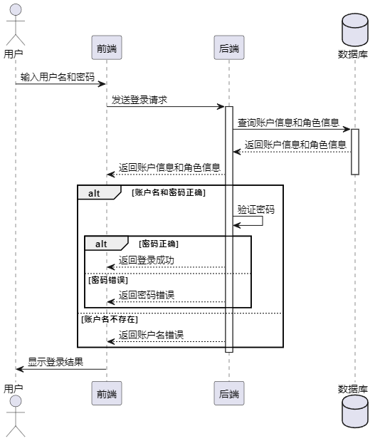

图4.2 登录时序图

#### 用户管理功能设计

服务端Koa接收前端传来的账户信息，如果请求中未指定角色，则默认分配角色为普通用户。通过用户名查询数据库，判断当前用户名是否已存在，如果存在则返回错误信息。如果用户名不存在，则对密码进行加密处理，然后对用户账号进行唯一性判断，如果判断通过则调用数据库添加方法，将数据添加至数据库，如果判断未通过则提示账号重复，最后根据添加结果返回相应的消息，如果添加成功则返回注册成功的消息，否则返回注册失败的消息，时序图如图4.3所示。

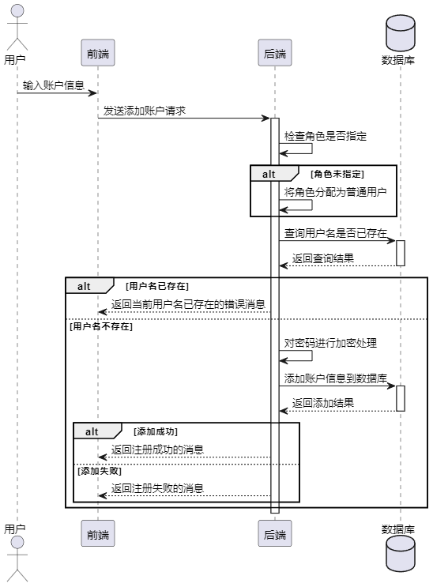

图4.3 用户添加时序图

#### 权限管理功能实现

角色修改时序图如图4.4所示，前端通过PUT请求，将参数发送给服务端，服务端从请求路径中获取角色ID，然后查询数据库获取该角色的详细信息。如果角色ID为'1'，表示超级管理员角色，不允许修改，则返回相应的错误消息。如果角色ID不是超级管理员，则根据请求中携带的角色信息进行更新操作。如果请求中只包含角色状态信息，则只更新角色状态；如果请求中包含了角色名称、描述等信息，则更新角色的全部信息。更新完成后，返回相应的成功消息。

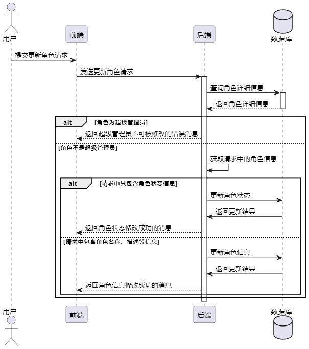

图4.4 角色修改时序图

角色权限修改时序图如图4.5所示，服务端从请求路径中获取角色ID，然后从请求体中获取角色菜单权限列表。接着，遍历菜单权限ID列表，构建角色菜单权限对象数组。然后调用服务层方法，将角色菜单权限列表更新到数据库中。根据更新结果，返回相应的消息，如果更新成功则返回成功消息，否则返回失败消息，角色操作权限修改设计逻辑与此一致。

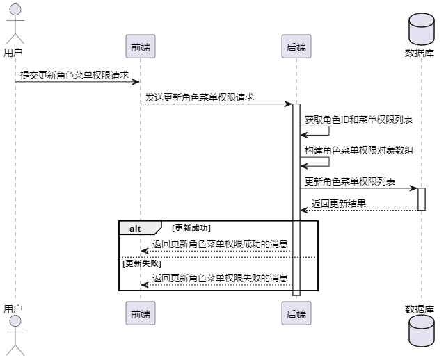

图4.5 角色菜单权限修改时序图

菜单渲染时序图如图4.6所示，系统后台进行了RBAC的权限逻辑设置，并且登录成功的用户也生成了token，因此服务端需要对所有后台操作请求进行拦截与客户端的动态菜单生成，服务端从请求头中获取用户的认证信息（token），根据token获取用户的角色信息，根据角色名称查询对应的角色ID，根据角色ID查询匹配的菜单列表ID，如果存在菜单列表，则根据菜单列表ID查询对应的路由信息，并构建路由对象数组，如果不存在则提示系统错误，表示该请求是非法请求。

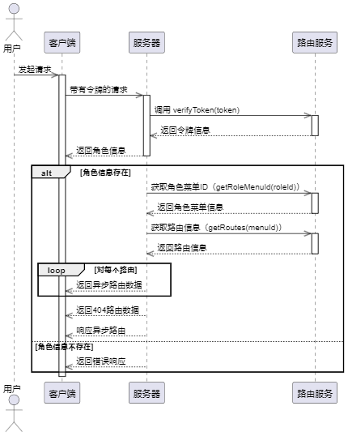

图4.6 菜单渲染时序图

#### 文章管理

文章创建时序图如图4.7所示，用户通过客户端发起创建新闻的请求，服务端接受到请求后，调用，NewsService的createArticle()方法创建新闻文章对象，然后进行对象属性值的初始化，如默认发布，创建时间，在对用户在客户端输入的值进行绑定，然后对数据库执行保存语句，将数据存入数据库中，并返回存入状态，如果存入成功，服务端提示客户端创建成功；如果存入失败，服务端提示客户端存入失败。

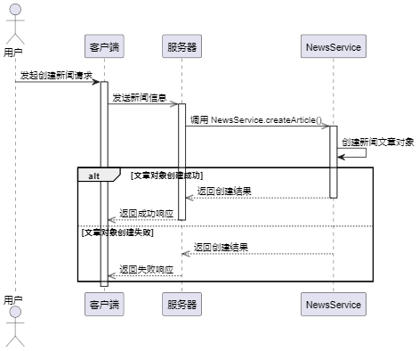

图4.6 新闻创建时序图

文章列表获取时序图如图4.7所示，客户端可以通过HTTP请求获取文章列表，服务端接收到请求后，根据参数调用NewsService中的getArticleList方法从数据库中获取文章列表数据。如果查询到符合条件的文章数据，则将数据进行格式化处理（时间格式化、类型处理等），然后返回给前端，前端接收到数据后，可以在页面上展示文章列表，包括文章的标题、内容、更新时间等信息。

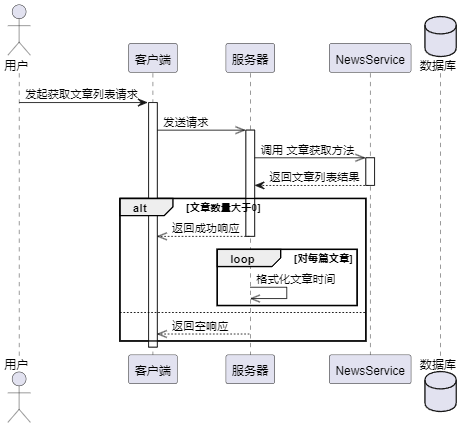

图4.7 文章获取时序图

#### 图片上传功能设计

文章添加与修改，用户添加，新闻创建与修改，职位创建修改等功能都涉及到图片上传，图片上传时序图如图4.8所示，用户向客户端提起文件上传操作，客户端通过HTTP向服务端发起文件上传请求，当服务端接收到前端发送的文件上传请求时，首先判断是否存在上传的文件。如果存在上传的文件，则获取文件的 URL，并根据配置决定是否将文件上传至远程服务器。如果配置中启用了远程上传，则使用文件读取流读取本地文件，并通过上传文件函数将文件上传至远程服务器，并返回上传成功后的文件 URL。最后，将文件 URL 返回给前端，并返回状态码 200 和成功消息。如果未收到上传的文件，则返回状态码 -1 和错误消息给前端。

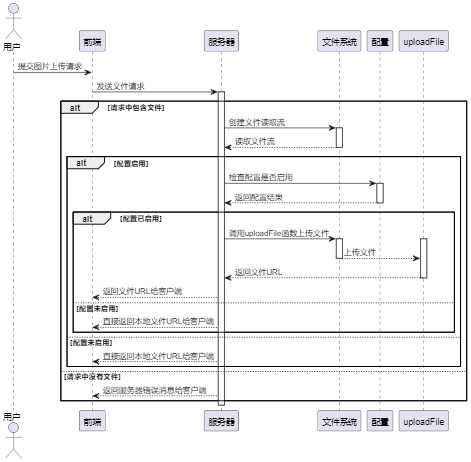

图4.8 图片上传

#### 新闻查看

前台用户新闻查看时序图如图4.9所示，新闻的三种查询方式基本一致，都是对数据库执行不同查询语句，如时序图所示，接口接收前端发送的查询参数，包括页码、每页条数以及其他可能的查询条件，如新闻类型、日期等，然后将查询参数传递给列表查询方法，该方法从数据库中获取符合条件的新闻列表数据。如果查询到的新闻数据数量大于0，则将数据进行格式化处理，将日期格式化为年-月-日的形式，并将格式化后的新闻数据组装成一个新闻列表，包括新闻的标题、内容、发布日期等信息。最后，将新闻列表、总数以及每页限制数返回给前端，并返回状态码200和成功消息。如果未查询到符合条件的新闻数据，则直接返回空列表，并返回状态码200和成功消息。

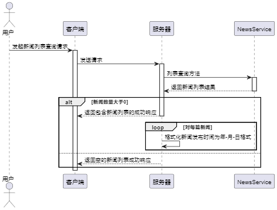

图4.9 新闻查看时序图

#### 职位查看

前台用户职位详情查看时序图如图4.10所示，用户通过点击职位列表，向前端发起职位详情数据获取请求，接口接收前端发送的职位ID，通过该ID调用JobService中的getJobDetail方法从数据库中获取对应职位的详细信息。

如果成功获取到职位详情，则将获取到的数据进行格式化处理，包括将时间字段格式化为年-月-日的形式，并组装成一个包含职位标题、城市、职位类别、描述、要求、发布时间和更新时间的职位详情对象。最后，将格式化后的职位详情对象返回给前端，并返回状态码200和成功消息。

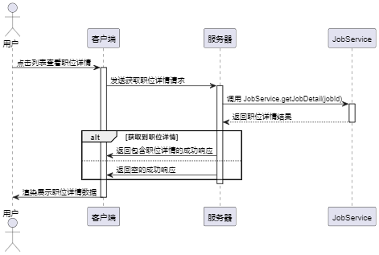

图4.10 职位详情查看时序图

### 数据库设计

#### 实体关系设计

根据系统需求分析和功能设计，本系统涉及多个实体，包括用户、文章、文章分类、角色、权限、角色菜单权限、角色功能权限、产品、职位、职位分类、以及职位所在地区等。其中，用户与角色存在多对一的关系，角色与权限是多对多的关系。另外，职位与职位分类是多对一的关系，职位与职位所在地区也是多对一的关系。系统的实体关系图能够清晰展现各个实体之间的关联关系，为系统的功能实现提供了重要的参考依据和设计思路。通过RBAC权限模型的引入，系统能够实现对用户、角色和权限的灵活管理，保障系统的安全性和可维护性，系统数据库E-R图如图4.11所示。

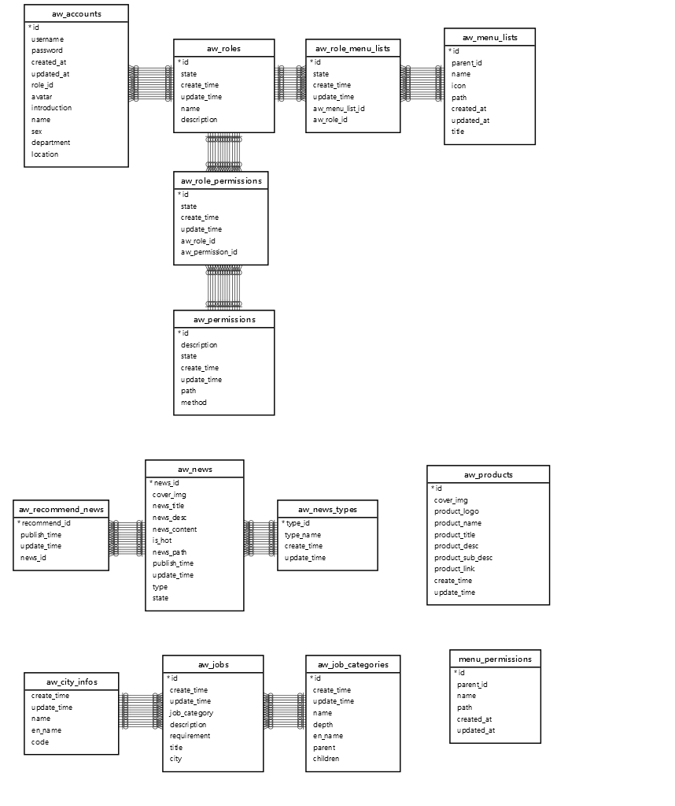

图4.11 E-R图

#### 数据库表设计

后台用户表字段包括头像、创建时间、部门、主键、介绍、位置、姓名、密码、关联角色、性别、修改时间和名称，其中主要字段为role_id关联角色表，具体如表4.1所示

表4.1 后台用户表

<table>
<tr><td>字段名</td><td>数据类型</td><td>主键/允许空</td><td>字段含义</td></tr>
<tr><td>avatar</td><td>varchar(1500)</td><td>NULL</td><td>头像</td></tr>
<tr><td>created_at</td><td>datetime</td><td>NOT NULL</td><td>创建时间</td></tr>
<tr><td>department</td><td>varchar(255)</td><td>NULL</td><td>部门</td></tr>
<tr><td>id</td><td>int</td><td>PRIMARY KEY</td><td>主键</td></tr>
<tr><td>introduction</td><td>varchar(255)</td><td>NULL</td><td>介绍</td></tr>
<tr><td>location</td><td>varchar(255)</td><td>NULL</td><td>位置</td></tr>
<tr><td>name</td><td>varchar(255)</td><td>NULL</td><td>姓名</td></tr>
<tr><td>password</td><td>varchar(255)</td><td>NOT NULL</td><td>密码</td></tr>
<tr><td>role_id</td><td>int</td><td>PRIMARY KEY</td><td>关联角色表</td></tr>
<tr><td>sex</td><td>varchar(255)</td><td>NULL</td><td>性别</td></tr>
<tr><td>updated_at</td><td>datetime</td><td>NOT NULL</td><td>修改时间</td></tr>
<tr><td>username</td><td>varchar(255)</td><td>NOT NULL</td><td>名称</td></tr>
</table>

角色表如表4.2所属，包括字段id主键，name角色名称，state状态。

表4.2 角色表

<table>
<tr><td>字段名</td><td>数据类型</td><td>主键/允许空</td><td>字段含义</td></tr>
<tr><td>create_time</td><td>datetime</td><td>NOT NULL</td><td>创建时间</td></tr>
<tr><td>description</td><td>varchar(255)</td><td>NOT NULL</td><td>角色描述</td></tr>
<tr><td>id</td><td>int</td><td>PRIMARY KEY</td><td>主键</td></tr>
<tr><td>name</td><td>varchar(255)</td><td>NOT NULL</td><td>角色名称</td></tr>
<tr><td>state</td><td>tinyint(1)</td><td>NOT NULL</td><td>状态：1/正常</td></tr>
<tr><td>update_time</td><td>datetime</td><td>NOT NULL</td><td>修改时间</td></tr>
</table>

权限表如表4.3所示，存储的是系统的权限数据包括菜单权限与功能权限。

表4.3 权限表

<table>
<tr><td>字段名</td><td>数据类型</td><td>主键/允许空</td><td>字段含义</td></tr>
<tr><td>create_time</td><td>datetime</td><td>NOT NULL</td><td>创建时间</td></tr>
<tr><td>description</td><td>varchar(255)</td><td>NOT NULL</td><td>权限描述</td></tr>
<tr><td>id</td><td>int</td><td>PRIMARY KEY</td><td>主键</td></tr>
<tr><td>method</td><td>varchar(255)</td><td>NOT NULL</td><td>请求方法</td></tr>
<tr><td>path</td><td>varchar(255)</td><td>NOT NULL</td><td>权限请求路径</td></tr>
<tr><td>state</td><td>tinyint(1)</td><td>NOT NULL</td><td>状态：1/正常</td></tr>
<tr><td>update_time</td><td>datetime</td><td>NOT NULL</td><td>修改时间</td></tr>
</table>

角色权限表如表4.4所示，角色权限表是角色表与权限表多对多关系的衍生表主要字段为aw_role_id与aw_permission_id。

表4.4 角色权限表

<table>
<tr><td>字段名</td><td>数据类型</td><td>主键/允许空</td><td>字段含义</td></tr>
<tr><td>aw_permission_id</td><td>int</td><td>PRIMARY KEY</td><td>权限表主键</td></tr>
<tr><td>aw_role_id</td><td>int</td><td>PRIMARY KEY</td><td>角色表主键</td></tr>
<tr><td>create_time</td><td>datetime</td><td>NOT NULL</td><td>创建时间</td></tr>
<tr><td>id</td><td>int</td><td>PRIMARY KEY</td><td>主键</td></tr>
<tr><td>state</td><td>int</td><td>NOT NULL</td><td>状态：1/正常</td></tr>
<tr><td>update_time</td><td>datetime</td><td>NOT NULL</td><td>修改时间</td></tr>
</table>

新闻表也就是文章表如表4.5所示，包括封面、热门状态、内容、简要描述、主键、访问路径、标题、发布时间、状态和修改时间，主要字段为is_hot表示是否为热门新闻，state表示文章新闻的状态。

表4.5 新闻文章表

<table>
<tr><td>字段名</td><td>数据类型</td><td>主键/允许空</td><td>字段含义</td></tr>
<tr><td>cover_img</td><td>varchar(255)</td><td>NULL</td><td>新闻列表项封面</td></tr>
<tr><td>is_hot</td><td>tinyint(1)</td><td>NOT NULL</td><td>新闻是否热门</td></tr>
<tr><td>news_content</td><td>text</td><td>NULL</td><td>新闻内容</td></tr>
<tr><td>news_desc</td><td>varchar(255)</td><td>NOT NULL</td><td>新闻列表项简要描述</td></tr>
<tr><td>news_id</td><td>int</td><td>PRIMARY KEY</td><td>主键</td></tr>
<tr><td>news_path</td><td>varchar(255)</td><td>NULL</td><td>新闻访问路径</td></tr>
<tr><td>news_title</td><td>varchar(255)</td><td>NOT NULL</td><td>新闻标题</td></tr>
<tr><td>publish_time</td><td>datetime</td><td>NOT NULL</td><td>发布时间</td></tr>
<tr><td>state</td><td>tinyint(1)</td><td>NOT NULL</td><td>状态：true/已发布，false/草稿</td></tr>
<tr><td>type</td><td>int</td><td>PRIMARY KEY</td><td>状态</td></tr>
<tr><td>update_time</td><td>datetime</td><td>NOT NULL</td><td>修改时间</td></tr>
</table>

产品表如表4.6所示，主要存储公司产品数据，主要字段conver_img产品图，product_link产品的链接。

表4.6 产品表

<table>
<tr><td>字段名</td><td>数据类型</td><td>主键/允许空</td><td>字段含义</td></tr>
<tr><td>cover_img</td><td>varchar(255)</td><td>NOT NULL</td><td>产品图片</td></tr>
<tr><td>create_time</td><td>datetime</td><td>NOT NULL</td><td>创建时间</td></tr>
<tr><td>id</td><td>int</td><td>PRIMARY KEY</td><td>主键</td></tr>
<tr><td>product_desc</td><td>varchar(255)</td><td>NOT NULL</td><td>产品描述</td></tr>
<tr><td>product_link</td><td>varchar(255)</td><td>NULL</td><td>产品详情链接</td></tr>
<tr><td>product_logo</td><td>varchar(255)</td><td>NOT NULL</td><td>产品logo</td></tr>
<tr><td>product_name</td><td>varchar(255)</td><td>NULL</td><td>产品英文名称</td></tr>
<tr><td>product_sub_desc</td><td>varchar(255)</td><td>NULL</td><td>产品详细描述</td></tr>
<tr><td>product_title</td><td>varchar(255)</td><td>NOT NULL</td><td>产品中文名称</td></tr>
<tr><td>update_time</td><td>datetime</td><td>NOT NULL</td><td>修改时间</td></tr>
</table>

职位表如表4.7所示，主要字段为city，job_category，title前台用户可以根据这个进行职位查询。

表4.7 职位表

<table>
<tr><td>字段名</td><td>数据类型</td><td>主键/允许空</td><td>字段含义</td></tr>
<tr><td>city</td><td>varchar(255)</td><td>PRIMARY KEY</td><td>城市</td></tr>
<tr><td>create_time</td><td>datetime</td><td>NOT NULL</td><td></td></tr>
<tr><td>description</td><td>varchar(255)</td><td>NOT NULL</td><td>职位描述</td></tr>
<tr><td>id</td><td>int</td><td>PRIMARY KEY</td><td>主键</td></tr>
<tr><td>job_category</td><td>int</td><td>PRIMARY KEY</td><td>分类</td></tr>
<tr><td>requirement</td><td>text</td><td>NOT NULL</td><td>职位要求</td></tr>
<tr><td>title</td><td>varchar(255)</td><td>NOT NULL</td><td>职位名称</td></tr>
<tr><td>update_time</td><td>datetime</td><td>NOT NULL</td><td>更新时间</td></tr>
</table>

职位分类表如表4.8所属，主要字段为id与parent，通过这两个字段构造职位分类树，前台根据这个结构进行树形选项框的展示。

表4.7 职位分类表

<table>
<tr><td>字段名</td><td>数据类型</td><td>主键/允许空</td><td>字段含义</td></tr>
<tr><td>children</td><td>int</td><td>NULL</td><td>父级职位类别</td></tr>
<tr><td>create_time</td><td>datetime</td><td>NOT NULL</td><td>创建时间</td></tr>
<tr><td>depth</td><td>int</td><td>NOT NULL</td><td>部门</td></tr>
<tr><td>en_name</td><td>varchar(255)</td><td>NOT NULL</td><td>职位类别</td></tr>
<tr><td>id</td><td>int</td><td>PRIMARY KEY</td><td>主键</td></tr>
<tr><td>name</td><td>varchar(255)</td><td>NOT NULL</td><td>职位类别</td></tr>
<tr><td>parent</td><td>int</td><td>NULL</td><td>父级职位类别</td></tr>
<tr><td>update_time</td><td>datetime</td><td>NOT NULL</td><td>更新时间</td></tr>
</table>

## 系统实现

### 前台实现

#### 首页

首页Banner实现界面如图5.1组成，页面底层为Swiper轮播图，并对其使用Z-index属性进行置底操作，然后左上方为Banner导航栏，前台用户可以通过点击的方式进行其他页面的访问，使用了Vue的router-link组件。

图5.1 首页Banner

首页整体由6个组件组成，其中有两个公用组件：AwHeader与AwFooter，改公用组件组成页面整体的顶部导航与底部导航，然后中间有4个组件：Banner，over-lay，scroll-hint，index-service组成首页整体内容，其中Banner组件为图5.1的轮播图，over-lay组件为轮播图上的文字描述，index-service组件为首页其他内容如图5.2所示，采用组件的开发方式可以提高系统相应效率，并且满足了可维护性与可扩展性需求。

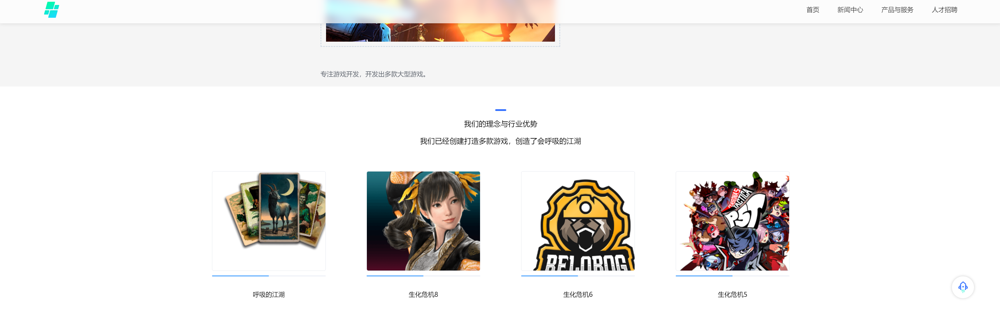

图5.2 首页其他页面

Banner实现主要代码如下所示，通过el-carousel组件实现轮播功能，设置了轮播间隔、箭头显示、高度、自动播放等属性。通过v-for指令循环渲染轮播项，其中的每一项包含一张图片，数据的绑定通过Vue的双向绑定实现，在data中定义轮播图集合imgList。

<template>
 

 

 <el-carousel :interval="2000" arrow="hover" :height="bannerHeight + 'px'" :autoplay="true" ref="carousel"
 trigger="click" indicator-position="none">
 <el-carousel-item v-for="item in imgList" :key="item.id">
 

 

 
 

 </el-carousel-item>
 </el-carousel>
 

 

</template>

#### 新闻查询

新闻查询界面如图5.3所示，除了公共组件的引用，界面中的输入框使用了饿了么UI的el-autocomplete组件，进行远程搜索，当用户输入关键词时，会触发querySearchAsync方法进行异步搜索，将搜索结果展示在下拉列表中。在搜索结果中，将匹配到的关键词用蓝色标记。这通过在搜索结果中遍历并替换匹配到的关键词为带有蓝色样式的HTML标签来实现。使用setTimeout函数设置延迟执行，避免频繁请求后端接口，界面下方使用了el-card组件对新闻分类数据进行循环，实现了卡片切换框，然后使用了router-link组件进行页面跳转，跳转到当前界面，携带分类参数，进行分类查询，新闻列表的实现使用了饿了么UI的el-card组件与el-pagination分页组件，实现了新闻文章卡片展示与分页查询。

服务端查询主要代码如下所示，代码使用了Sequelize提供的findAndCountAll方法从数据库中查询新闻数据。根据给定的查询条件（新闻类型、发布日期、状态），获取符合条件的新闻列表，并按照发布时间降序排序。

return News.findAndCountAll({
 where: {
 [Op.and]: [
 { type: params.activeName },
 {
 publish_time: {
 [Op.startsWith]: params.selectDate
 },
 },
 { state: 1 }
 ]
 },
 attributes: { exclude: ['news_content'] },
 limit: parseInt(params.pagesize),
 // 跳过实例数目
 offset: (params.pagenum - 1) * parseInt(params.pagesize),
 order: [
 ['publish_time', 'DESC']
 ]
})

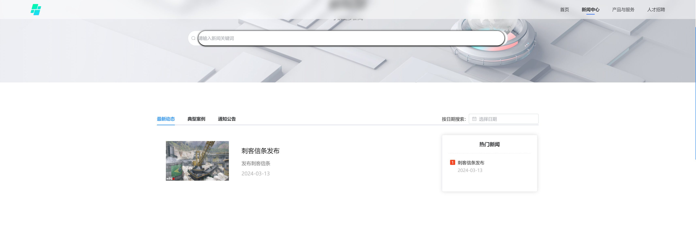

图5.3 新闻列表

前台用户点击卡片列表中的一张卡片，客户端会跳转到新闻详情界面，并传入新闻文章主键参数，请求服务端接口：/article/17103305221064305，其中17103305221064305为文章主键，服务端根据文章主键进行数据库查询，然后详情界面通过Vue的双向绑定获取数据，并在界面上渲染出来，其中富文本内容的渲染使用了v-html进行渲染，主要代码如下所示。

async function getNewsDetails() {
 const { data: res } = await getNewsDetailsApi(news_path.value)
 if (res.status !== 200) {
 console.log(res)
 } else {
 // this.$message.success('获取成功')
 news_detail.value= {
 title: res.data.news_detail.news_title, publish_time: res.data.news_detail.publish_time,
 content: res.data.news_detail.news_content,
 type: res.data.news_detail.aw_news_type.type_name
 }
 }
}

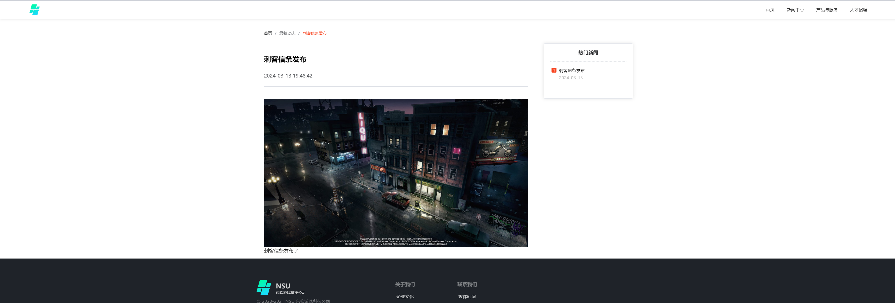

图5.4 新闻详情

#### 产品查询

产品界面如图5.5所示，页面包含一个顶部导航栏和一个包裹产品展示部分的容器。产品展示部分由一个横向滚动的导航条和一个显示产品详情的区域组成。在产品详情区域，使用了Vue的过渡效果，在切换产品时会有向上或向下的滑动动画。同时，根据滚动方向的不同，会触发不同的动画效果，使页面变得更加生动。整体样式通过Less预处理器编写，包括了背景颜色、元素位置和动画效果的定义。通过Vue Router的导航守卫，控制了页面在路由离开时的状态变化，服务端数据获取主要代码如下所示，使用 Sequelize 提供的 findAll 方法从数据库中获取产品数据

async getProducts () {
 return Products.findAll({
 attributes: { exclude: ['create_time', 'update_time'] }

图5.5 产品列表

#### 职位查询

职位列表界面如图5.6所示，页面分为顶部的标题栏、包含搜索框和筛选条件的侧边栏，以及职位列表展示区域。组件初始化时，通过调用 getJobConfigRequest() 方法获取职位筛选条件数据，包括职位类别和城市列表。同时，调用 getJobList() 方法获取初始的职位列表数据。用户可以在搜索框中输入关键词进行搜索。搜索框支持实时搜索，当输入关键词时，会根据关键词请求匹配的职位数据，并实时更新页面显示结果。用户可以通过侧边栏中的筛选条件进行职位筛选。选择职位类别和城市后，会根据选择的条件请求匹配的职位数据，并更新页面显示结果。页面滚动时，通过监听滚动事件，实现了页面顶部的搜索框固定效果。当页面滚动超过一定距离时，搜索框会固定在页面顶部，以提供更便捷的搜索体验。根据获取的职位数据，动态渲染职位列表。每个职位项包含职位标题、城市、职位类别和职位描述等信息，并提供跳转链接，使用户能够查看详细信息。使用 Element Plus 的分页组件实现了分页功能，用户可以通过分页器切换不同页码查看更多的职位信息。

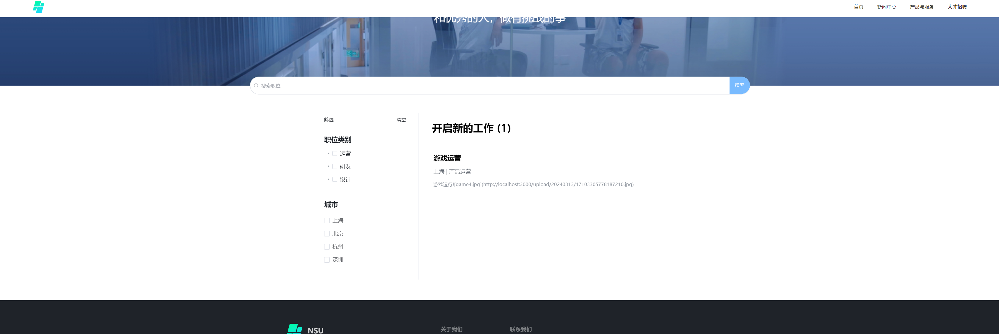

图5.6 职位列表

用户点击职位列表中的一列，客户端跳转到职位详情界面，页面由顶部标题栏、职位详细信息展示区域和底部页脚组成。通过调用 getJobDetail() 方法获取特定职位的详细信息，根据路由参数中的职位 ID 请求对应的职位详情数据。根据获取的职位详情数据，动态渲染职位标题、所在城市、职位类别、发布时间、更新时间、职位描述和职位要求等信息。提供了一个按钮，点击按钮可跳转至默认邮件客户端并预填写收件人邮箱地址，方便用户进行职位投递，投递代码如下所示：

<el-button round type = "primary" style="width: 150px"><a href = "mailto:[邮箱已移除]">投递</a></el-button>

图5.7 职位详情

### 后台实现

#### 登录

登录界面如图5.8所示，页面由标题、账号输入框、密码输入框、登录按钮和注册链接组成，使用了 Element UI 的 Form 和 Input 组件。使用了 Element UI 的 Form 组件进行表单验证，定义了账号和密码的验证规则，要求账号和密码都是由4-9位数字和字母组合。提供了一个按钮，点击可以切换密码的显示和隐藏状态，通过设置密码输入框的 type 属性来实现。当用户点击登录按钮时，先进行表单验证，通过验证后调用后端接口进行登录，登录成功后跳转至指定页面，登录失败则显示错误提示，服务端主要代码如下所示，首先，从数据库中获取加密后的密码。然后，创建一个包含用户角色信息和用户名的对象。接着，验证输入的密码和数据库中的加密密码是否匹配。最后，基于用户信息生成一个令牌。

const encryPwd = count[0].dataValues.password
let roleName = []
roleName.push(roleInfo[0].dataValues.aw_role.dataValues.name)
const userInfo = {
 id: count[0].dataValues.id,
 roles: roleName,
 name: count[0].dataValues.username,
 avatar: count[0].dataValues.avatar,
}
const flag = await verifyPwd(password, encryPwd)
const token = createToken(userInfo)

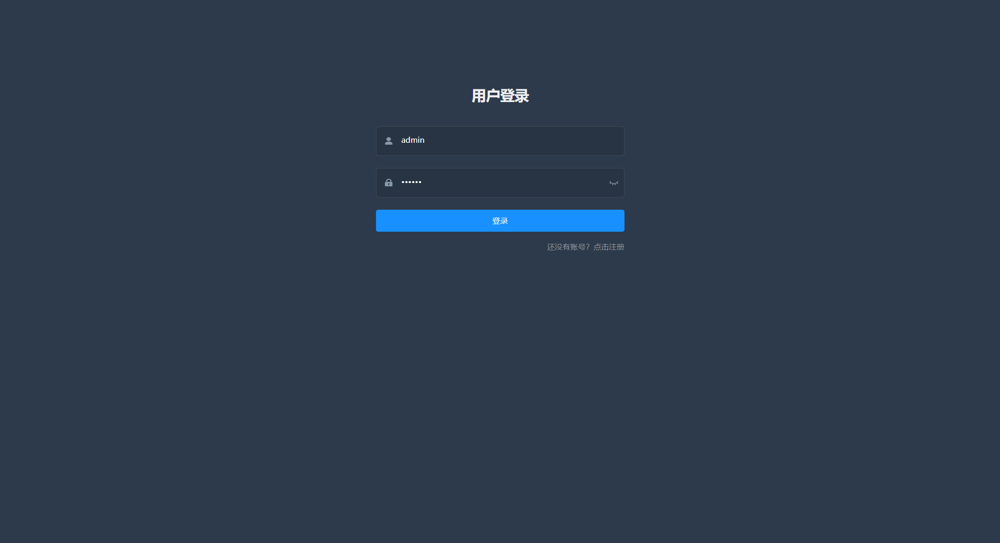

图5.8 登录

#### 权限管理实现

用户登录成功后会访问接口admin/routes，获取登录用户的所有权限数据信息，通过登录生成的token获取，使用了第四章数据库设计中的角色表，权限表与角色权限表，前端根据服务端返回的值，进行动态路由的构建，generateRoutes 方法接收用户角色作为参数，首先通过调用 getAsyncRoutes 方法获取异步路由信息，然后根据用户角色对路由进行过滤，最后将过滤后的路由提交给 Vuex 存储。如果用户角色包含 'admin'，则返回所有权限路由；否则，返回根据用户角色过滤后的权限路由。

makePermissionRouters 函数用于将服务端返回的动态路由信息与前端保存的动态路由信息进行匹配和合并。对于前端保存的每一个路由，通过匹配其名称与服务端返回的路由信息，将对应的权限信息合并到前端保存的路由中。如果某个路由有子路由，则递归处理子路由。最终返回处理后的前端保存的动态路由信息，代码如下所示：

const actions = {
 async generateRoutes({ commit }, roles) {
 let PermissionRouters = await getAsyncRoutes().then(res => {
 const data = res.data.data.asyncRoutes
 PermissionRouters = makePermissionRouters(data, clientRoutes)
 return PermissionRouters
 })
 // console.log(PermissionRouters)
 return new Promise(resolve => {
 let accessedRoutes
 if (roles.includes('admin')) {
 accessedRoutes = PermissionRouters || []
 } else {
 accessedRoutes = filterAsyncRoutes(PermissionRouters, roles)
 // console.log(accessedRoutes)
 }
 // console.log(accessedRoutes)
 commit('SET_ROUTES', accessedRoutes)
 resolve(accessedRoutes)
 })
 }
}

角色管理界面如图5.9所示，界面使用了饿了么UI的el-table组件进行实现，使用Vue的双向绑定进行角色值的绑定的渲染，服务端数据获取的方式的使用了Sequelize框架的findall方法，用户点击编辑或者新增按钮，客户端弹出弹窗，通过el-dialog组件实现，弹窗内部为Form表单，由el-from组件实现，用户输入完所有信息后，点击提交修改，客户端通过Axios向服务端发送HTTP请求，服务端对数据库进行更新或者修改操作。

图5.9 角色管理界面

角色权限编辑界面如图5.10所示，使用 <el-dialog> 组件作为编辑弹窗的容器，并设置 :visible.sync 属性来控制弹窗的显示与隐藏。在弹窗中使用 <el-tree> 组件展示菜单或操作权限树形结构，并设置相应的属性来控制树形结构的显示。定义 dialogTitle 和 dialogVisible 两个变量，分别用于控制编辑弹窗的标题和显示状态。定义 editId 用于存储当前编辑的角色ID。定义 treeData 用于存储树形结构的数据。定义 checkedKeys 用于存储已勾选的节点。 menuClick 和 operationClick 方法中，分别处理菜单权限和操作权限的点击事件。在点击事件中，设置 dialogTitle 和 dialogVisible 变量，打开对应的编辑弹窗，并根据角色ID获取对应的菜单或操作权限数据，并将数据格式化后赋值给 treeData，同时获取已有权限并设置到 checkedKeys 中，以展示已有权限的勾选状态。updateMenu 和 updateOperation 方法中，分别处理更新菜单权限和操作权限的逻辑。通过 $refs.tree.getCheckedKeys() 方法获取当前勾选的权限，然后调用相应的 API 方法将权限更新到后端数据库中。

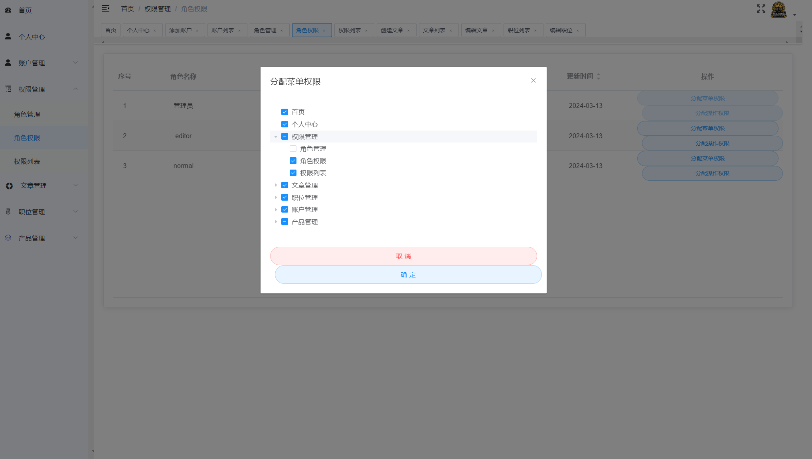

图5.10 角色权限编辑界面

#### 用户管理实现

用户管理列表界面如图5.11所示，用于显示账户列表，每一行显示账户名、介绍、头像、所属角色和操作按钮。点击编辑按钮可以打开编辑对话框，编辑账户信息。点击删除按钮可以删除相应账户。编辑对话框包含账户名称、介绍、密码和所属角色的输入框和下拉框，点击确定修改按钮可以提交修改。

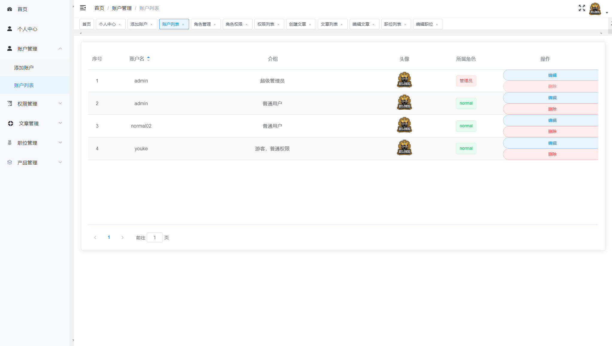

图5.11 用户管理列表界面

账户添加列表界面如图5.12所示，用于添加账户信息。表单包括账户名称、介绍、头像、所属角色和密码等字段。其中，头像采用上传图片的方式实现，点击上传按钮可以选择图片并上传，上传成功后显示图片预览。在上传过程中，还包含上传进度的显示。对于上传的图片，可以点击预览按钮查看大图，并支持移除已上传的图片。

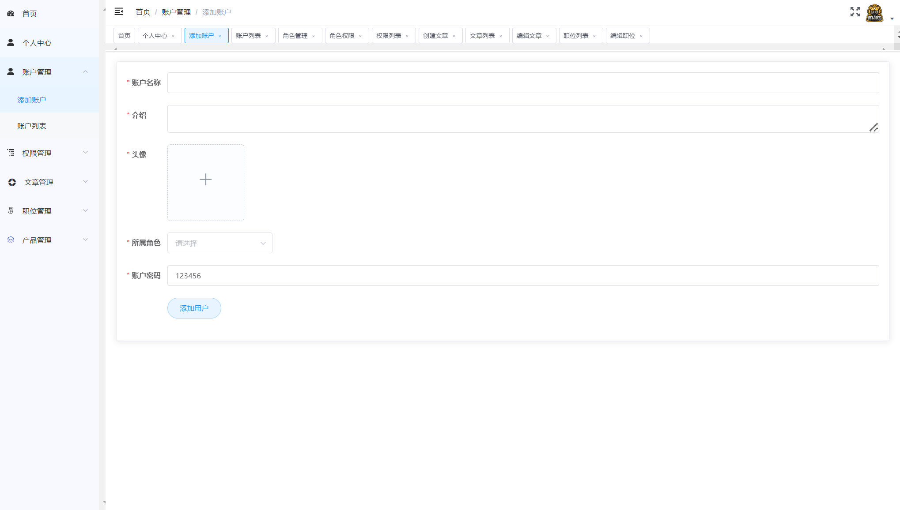

图5.12 账户添加列表界面

#### 文章管理实现

文章创建界面如图5.13所示，用户可以填写文章标题、摘要、选择文章类别，并使用富文本编辑器编辑文章内容。其中，封面图片上传功能允许用户选择上传文章的封面图片。上传的图片会以缩略图的形式展示在表单中，并提供预览功能。如果用户不修改封面图片，则保留原封面图片。

使用了Element UI的表单组件（el-form）和上传组件（el-upload），并结合了自定义的富文本编辑器组件（wangEditor）。通过设置表单的数据模型（postForm）和校验规则（rules），实现了对表单内容的有效验证。在提交或更新文章时，通过调用相应的API接口（createArticle和updateArticle）来实现数据的保存和更新。

图片上传功能借助了上传组件的相关属性和事件，如设置上传地址（action）、上传前的校验（before-upload）、上传中的进度显示（on-progress）等。在上传成功后，将返回的图片地址保存到表单的封面图片字段（coverImg）中，并提供了移除和预览已上传图片的功能。

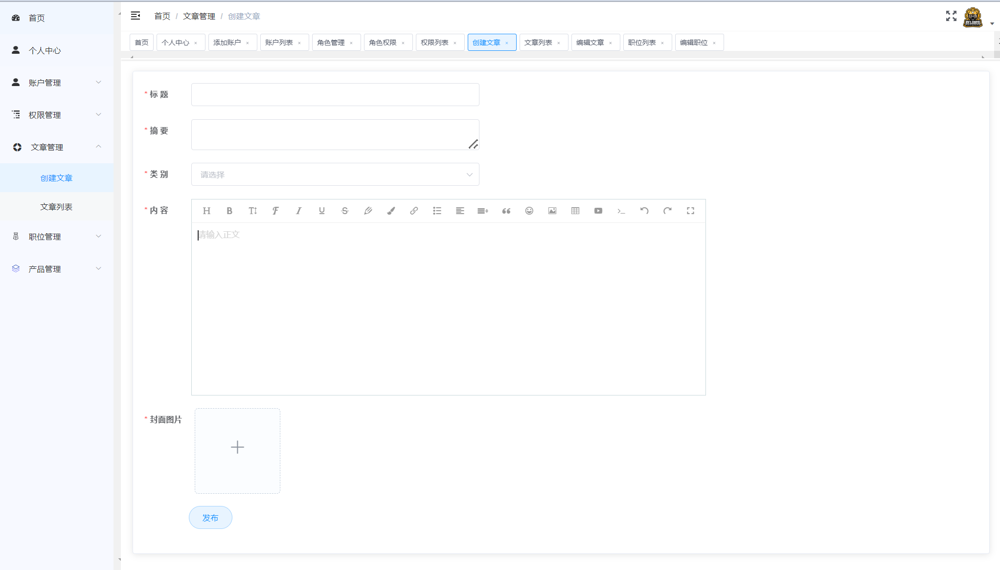

图5.13 文章创建界面

#### 产品管理实现

产品列表界面如图5.14所示，使用了Element UI的表格组件（el-table）来展示产品数据。每一行代表一个产品，包括产品名称、简要描述、详细描述、链接和 logo。在操作列中，用户可以点击“编辑”按钮跳转到编辑页面，也可以点击“删除”按钮删除该产品。通过调用 API 接口获取产品列表数据，然后将数据渲染到表格中。在删除产品时，用户需要确认操作，确认删除后触发相应的删除函数，删除成功后重新获取产品列表数据并给出提示。

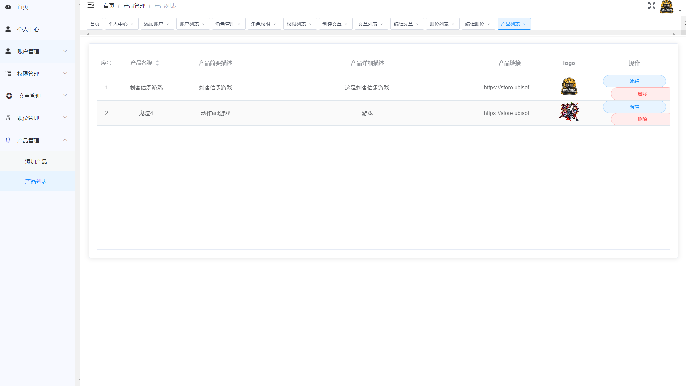

图5.14 产品列表

#### 职位管理实现

职位编辑与创建界面如图5.15所示，使用el-form组件包裹表单，利用v-model将表单数据与jobForm对象双向绑定，确保输入的数据能够实时更新。使用ruleJobForm对象定义了表单的验证规则，确保用户输入的数据符合要求。在组件创建之前，通过beforeRouteEnter钩子函数获取职位分类和城市数据，并调用getJobDetail方法获取当前编辑的职位信息。使用mavon-editor组件实现了职位描述和职位要求的富文本编辑功能。通过imgAdd1和imgAdd2方法实现图片上传功能，通过imgDel1和imgDel2方法实现图片删除功能。用户填写完表单后，点击"修改职位"按钮，弹出确认框，确认修改后调用editJob方法。在editJob方法中，首先进行表单验证，验证通过后根据编辑的职位 ID 和表单数据调用updateJob方法更新职位信息。更新成功后，显示成功消息并清空表单，跳转到职位列表页面；更新失败则显示错误消息，并重新获取当前编辑的职位信息。

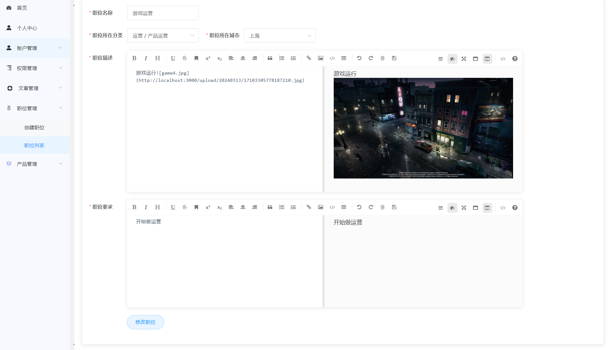

图5.15 职位编辑与创建界面

## 系统测试

### 测试环境与方法

测试环境搭建是确保软件产品质量的重要环节，对于基于Vue.js前端框架、Node.js服务端框架、以及KoaWeb框架开发的系统，测试环境的建立尤为关键。首先，需要确保在开发环境的基础上，搭建与生产环境相似的测试环境，以保证测试结果的可靠性和准确性。系统测试方法采用了黑盒测试方法，即基于系统功能和需求的外部行为进行测试，而不考虑内部实现细节。在测试过程中，测试人员不需要了解系统的内部结构，而是将系统视为一个黑盒子，通过输入输出的方式验证其功能是否符合预期

### 测试用例

#### 前台测试用例

前台测试用例中主要测试前台用户是否可以正常访问系统，在新闻查看界面，是否可以进行关键字查询，时间查询，是否可以查看某个新闻文章的详情，是否可以正常查看产品，在职位查看页面是否可以进行筛选，职位详情查看，简历投递，测试结果如表6.1所示。

表6.1 前台测试用例

<table>
<tr><td>测试序号</td><td>操作描述</td><td>数据</td><td>期望结果</td><td>实际结果</td><td>测试状态</td></tr>
<tr><td>1</td><td>前台用户访问系统</td><td>/</td><td>成功进入系统首页</td><td>成功进入系统</td><td>通过</td></tr>
<tr><td>2</td><td>在新闻查看界面进行关键字查询</td><td>关键字：&quot;测试&quot;</td><td>展示了有关测试的新闻</td><td>与期望一致</td><td>通过</td></tr>
<tr><td>3</td><td>在新闻查看界面进行时间查询</td><td>时间范围：2023-2024</td><td>显示符合时间范围的新闻列表</td><td>与期望一致</td><td>通过</td></tr>
<tr><td>4</td><td>查看某个新闻文章的详情</td><td>选择某个新闻文章</td><td>显示该新闻文章的详情</td><td>与期望一致</td><td>通过</td></tr>
<tr><td>5</td><td>查看产品</td><td>/</td><td>成功进入</td><td>与期望一致</td><td>通过</td></tr>
<tr><td>6</td><td>在职位查看页面进行筛选</td><td>选择筛选条件</td><td>显示符合筛选条件的职位列表</td><td>与期望一致</td><td>通过</td></tr>
<tr><td>7</td><td>查看职位详情</td><td>选择某个职位</td><td>显示该职位的详情</td><td>与期望一致</td><td>通过</td></tr>
<tr><td>8</td><td>点击投递</td><td>投递</td><td>客户端弹出邮件发送界面</td><td>与期望一致</td><td>通过</td></tr>
</table>

#### 登录测试用例

主要测试后台用户在登录时，输入错误的账号与密码，是否能被拦截，登录成功后，是否可以通过该用户的权限数据，进行菜单的渲染，没有登录的用户访问某些功能比如用户删除，是否会被系统拦截，测试结果如表6.2所示。

表6.2 登录测试用例表

<table>
<tr><td>测试序号</td><td>操作描述</td><td>数据</td><td>期望结果</td><td>实际结果</td><td>测试状态</td></tr>
<tr><td>1</td><td>后台用户输入错误的账号与密码尝试登录</td><td>错误的账号与密码</td><td>登录失败</td><td>与期望一致</td><td>通过</td></tr>
<tr><td>2</td><td>后台用户输入正确的账号与密码登录</td><td>正确的账号与密码</td><td>登录成功</td><td>与期望一致</td><td>通过</td></tr>
<tr><td>3</td><td>后台用户根据权限数据渲染菜单</td><td>用户权限数据 菜单根据用户权限正确显示</td><td>菜单根据用户权限正确显示</td><td>与期望一致</td><td>通过</td></tr>
<tr><td>4</td><td>未登录用户尝试访问用户删除功能</td><td>被删除的用户</td><td>拦截</td><td>拦截</td><td>通过</td></tr>
</table>

#### 权限管理测试用例

权限管理测试用例中主要测试角色是否可以进行创建，删除，修改，角色权限是否可以修改该角色对应的菜单权限与功能权限，权限被修改后，属于该角色的用户的权限是否被更新，测试结果如表6.3所示。

表6.3 权限管理测试用例

<table>
<tr><td>测试序号</td><td>操作描述</td><td>数据</td><td>期望结果</td><td>实际结果</td><td>测试状态</td></tr>
<tr><td>1</td><td>创建角色</td><td>角色基本信息</td><td>创建成功</td><td>与期望一致</td><td>通过</td></tr>
<tr><td>2</td><td>删除角色</td><td>角色主键</td><td>删除成功</td><td>与期望一致</td><td>通过</td></tr>
<tr><td>3</td><td>修改角色信息</td><td>角色基本信息</td><td>修改成功</td><td>与期望一致</td><td>通过</td></tr>
<tr><td>4</td><td>修改角色权限</td><td>角色主键，权限主键</td><td>修改成功</td><td>修改成功</td><td>通过</td></tr>
<tr><td>5</td><td>角色权限修改后，验证该角色对应用户的权限是否更新</td><td>角色对应的用户</td><td>被更新</td><td>被更新</td><td>通过</td></tr>
</table>

#### 文章管理测试用例

文章管理测试用例中主要测试文章的增加，修改，删除，展示状态修改，热点状态修改功能是否正常与设计一致，比如未展示的文章将不会展示在系统前台，不是热点的文章不会展示在新闻界面中的热点新闻中，测试结果如表6.4所示。

表6.4 文章管理测试用例

<table>
<tr><td>测试序号</td><td>操作描述</td><td>数据</td><td>期望结果</td><td>实际结果</td><td>测试状态</td></tr>
<tr><td>1</td><td>增加文章</td><td>文章数据</td><td>增加成功</td><td>成功</td><td>通过</td></tr>
<tr><td>2</td><td>修改文章</td><td>文章信息</td><td>成功修改文章</td><td>成功修改文章</td><td>通过</td></tr>
<tr><td>3</td><td>删除文章</td><td>待删除文章</td><td>成功删除文章</td><td>成功删除文章</td><td>通过</td></tr>
<tr><td></td><td>修改展示状态</td><td>文章ID、状态</td><td>修改成功</td><td>前台未展示该文章</td><td>通过</td></tr>
<tr><td></td><td>修改热点状态</td><td>文章ID、状态</td><td>修改成功</td><td>新闻热点中无该文章</td><td>通过</td></tr>
</table>

## 结论

在如今游戏行业竞争激烈的环境下，公司门户网站成为了展示品牌形象、吸引用户关注的重要平台之一。在这个项目中，我们以 Vue.js 技术为基础，致力于设计并实现一款现代化的游戏公司官网，旨在为游戏公司打造一个具有吸引力、功能丰富的在线展示平台。通过采用 Vue.js、Node.js、MySQL 等关键技术，我们成功地打造了一款功能齐全、界面美观的公司门户网站，包括官网首页展示、新闻中心、产品与服务介绍、人才招聘与查询等模块。

为了满足游戏公司的多样化需求，我们选择了 Node.js 作为服务端框架，利用其高效、轻量级的特性，实现了后台管理功能。通过后台管理系统，管理员可以方便地进行账户管理、角色权限分配、文章管理、职位管理、产品管理等操作，从而提升了公司内部管理的效率和灵活性。同时，采用 MySQL 数据库作为数据存储框架，保证了数据的安全性和稳定性，为后续的数据分析和业务拓展提供了有力支持。

在前端方面，我们采用了 Vue.js 框架作为前端开发的核心技术，结合其组件化、响应式的特点，实现了官网界面的设计与开发。通过 Vue.js 的灵活运用，我们不仅实现了网站的界面效果，还优化了用户体验，使得用户可以更加方便地浏览、了解和参与到公司的活动和产品中来。此外，我们还结合了现代化的前端开发技术，如响应式设计、动画效果等，进一步提升了网站的视觉效果和交互体验，吸引用户留存和参与。

通过本项目的设计与实现，我们成功地打造了一款符合游戏行业特点、功能完善、界面美观的公司门户网站。这不仅展示了公司的品牌形象和实力，也提升了公司的管理效率和用户体验，为公司的长期发展和市场竞争提供了有力支持。随着互联网技术的不断发展和创新，我们相信这款游戏官网系统将会在未来的发展中发挥越来越重要的作用，为公司的业务拓展和用户服务带来更多的机遇与挑战。
